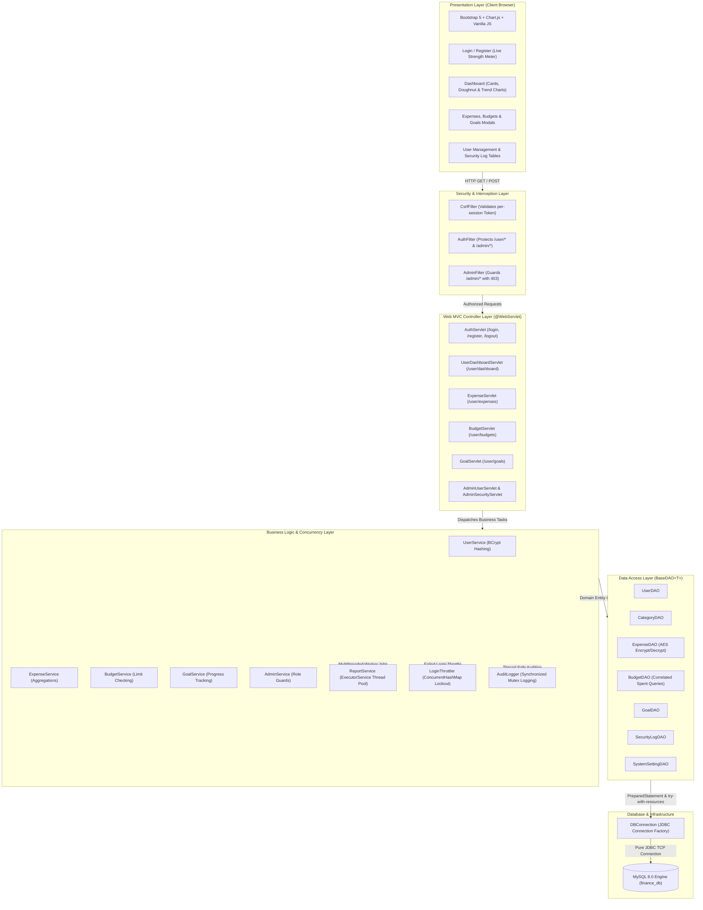

# Layered MVC System Architecture

This document describes the software architecture, data flow, and grading rubric components of the **Online Personal Finance Management Platform**.

---

## Layer Responsibilities

1. **Presentation Layer (JSP & Static Assets)**:
   - Uses Jakarta Standard Tag Library (`jakarta.tags.core`, `jakarta.tags.fmt`) for server-side HTML rendering.
   - Mobile-first responsive UI using Bootstrap 5, Bootstrap Icons, and Chart.js.
   - Interactive theme engine providing white & green in light mode and black & green in dark mode (saved in `localStorage`).

2. **Filter & Security Layer**:
   - `CsrfFilter`: Verifies state-changing HTTP POST operations using constant-time token comparison.
   - `AuthFilter`: Enforces 15-minute session timeouts and redirects unauthenticated users to `/login`.
   - `AdminFilter`: Restricts `/admin/*` operations exclusively to users with `ADMIN` privileges.

3. **Controller Layer (Servlets)**:
   - Implements the **Post-Redirect-Get (PRG)** design pattern to eliminate duplicate form resubmissions.
   - Stores user confirmation feedback in session flash attributes (`flashSuccess`, `flashError`, `flashWarning`).

4. **Service & Concurrency Layer**:
   - `ReportService`: Asynchronously compiles CSV exports and summary reports using an `ExecutorService` thread pool.
   - `AuditLogger`: Uses `synchronized` methods to ensure atomic, non-interleaved writes to security logs.
   - `LoginThrottler`: Manages failed login attempts in a thread-safe `ConcurrentHashMap` to lock accounts after 5 failures.

5. **Data Access Layer (DAOs)**:
   - Extends the generic `BaseDAO<T>` interface.
   - Uses exclusively `PreparedStatement` within Java `try-with-resources` blocks to eliminate SQL injection and connection leaks.
