# Database Entity-Relationship (ER) Diagram

This document illustrates the relational database model of the **Online Personal Finance Management Platform** (`finance_db`).

```mermaid
erDiagram
    users ||--o{ expenses : "logs"
    users ||--o{ budgets : "defines"
    users ||--o{ goals : "plans"
    users ||--o{ security_logs : "triggers"
    users ||--o{ system_settings : "configures"
    categories ||--o{ expenses : "classifies"
    categories ||--o{ budgets : "limits"

    users {
        int id PK "AUTO_INCREMENT"
        string name "NOT NULL"
        string email UK "UNIQUE, NOT NULL"
        string password_hash "BCrypt Hash, NOT NULL"
        string role "ENUM('USER', 'ADMIN')"
        string status "ENUM('ACTIVE', 'BLOCKED')"
        timestamp created_at "CURRENT_TIMESTAMP"
    }

    categories {
        int id PK "AUTO_INCREMENT"
        string name UK "UNIQUE, NOT NULL"
        string type "ENUM('EXPENSE', 'INCOME')"
    }

    expenses {
        int id PK "AUTO_INCREMENT"
        int user_id FK "REFERENCES users(id) ON DELETE CASCADE"
        int category_id FK "REFERENCES categories(id)"
        decimal amount "DECIMAL(10,2) CHECK (amount > 0)"
        date expense_date "NOT NULL"
        text note "AES-256 Encrypted Ciphertext"
        timestamp created_at "CURRENT_TIMESTAMP"
    }

    budgets {
        int id PK "AUTO_INCREMENT"
        int user_id FK "REFERENCES users(id) ON DELETE CASCADE"
        int category_id FK "REFERENCES categories(id)"
        decimal amount "DECIMAL(10,2) CHECK (amount > 0)"
        date start_date "NOT NULL"
        date end_date "NOT NULL"
        timestamp created_at "CURRENT_TIMESTAMP"
    }

    goals {
        int id PK "AUTO_INCREMENT"
        int user_id FK "REFERENCES users(id) ON DELETE CASCADE"
        string description "NOT NULL"
        decimal target_amount "DECIMAL(10,2) CHECK (target_amount > 0)"
        decimal saved_amount "DECIMAL(10,2) CHECK (saved_amount >= 0)"
        date deadline "NOT NULL"
        string status "ENUM('IN_PROGRESS', 'COMPLETED', 'CANCELLED')"
        timestamp created_at "CURRENT_TIMESTAMP"
    }

    security_logs {
        int id PK "AUTO_INCREMENT"
        int user_id FK "REFERENCES users(id) ON DELETE SET NULL"
        string action "NOT NULL"
        string ip_address "VARCHAR(45), NOT NULL"
        timestamp created_at "CURRENT_TIMESTAMP"
    }

    system_settings {
        int id PK "AUTO_INCREMENT"
        string setting_key UK "UNIQUE, NOT NULL"
        string setting_value "NOT NULL"
        int updated_by FK "REFERENCES users(id) ON DELETE SET NULL"
        timestamp updated_at "CURRENT_TIMESTAMP ON UPDATE"
    }
```

## Key Relational Design Principles

1. **Foreign Key Integrity**:
   - `expenses`, `budgets`, and `goals` cascade delete (`ON DELETE CASCADE`) when an underlying user profile is removed.
   - `security_logs` and `system_settings` use `ON DELETE SET NULL` to preserve historical audit data even if an administrator account is deleted.

2. **Domain Integrity Constraints**:
   - `CHECK (amount > 0)` prevents invalid zero or negative monetary inputs at the database engine level.
   - `CHECK (target_amount > 0)` and `CHECK (saved_amount >= 0)` ensure savings goals remain valid.

3. **Performance Optimization Indexes**:
   - Composite index `(user_id, expense_date)` accelerates date-range and monthly trend queries.
   - Unique index on `users(email)` ensures \(O(1)\) lookup during authentication.
   - Index on `security_logs(created_at)` provides high-throughput ordering for audit inspection.
